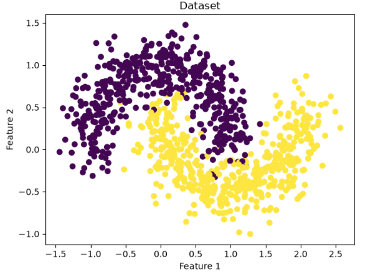
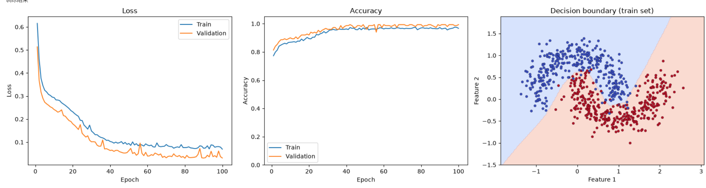
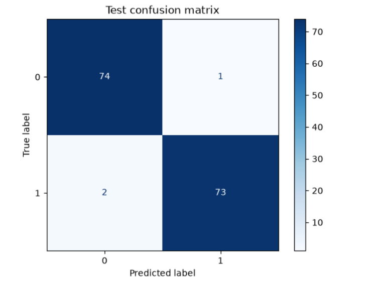
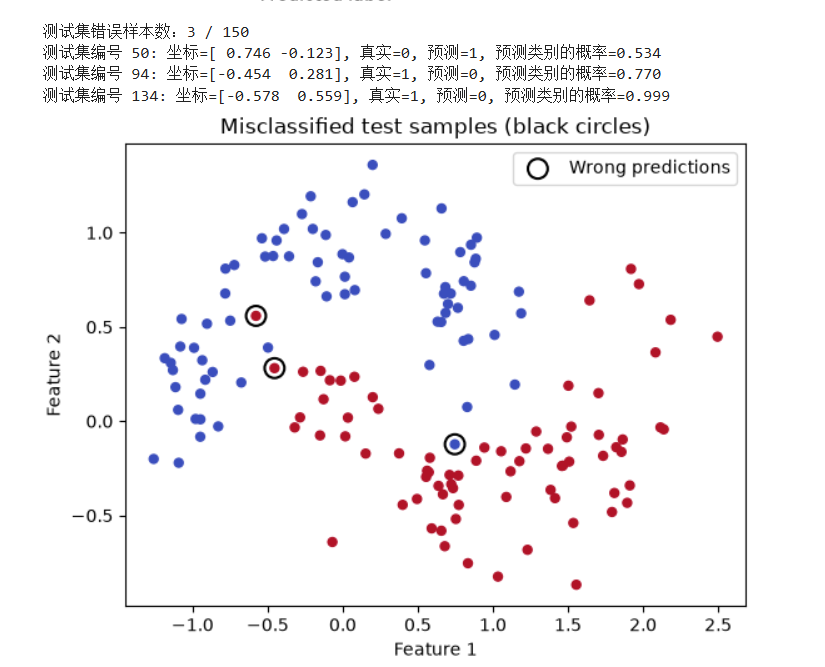

# Task 1
## 任务图表及说明，实验表格
1. 可视化原始数据

3. loss、accuracy 曲线及二维决策边界

4. 实验表格
[实验表格](MLP_对照实验.xlsx)
5. 混淆矩阵

错误样本分析：该模型在测试集上共有三个错误样本，其中靠近数据实际决策边界的样本点有两个，模型得出的置信度接近0.5，表明决策边界附近的样本难以分辨；一个样本点远离决策边界，但模型仍以较高置信度判断错误，推测由数据生成的噪声导致

## 趁热打铁
- ReLU，他是比较简单的激活函数，且不容易出现梯度消失或者梯度爆炸的问题
- 交叉熵损失CrossEntropyLoss，它将模型预测出的分数通过softmax变成概率，取负对数得到，能衡量模型预测的概率分布情况与真实情况的差异，模型给真实类别的概率越高，损失越小。对于三分类问题也可使用，只用变化MLP最后一层输出为3
- 清空上一批次累积的梯度；loss反向传播，参数自动求梯度；优化器根据计算的梯度更新参数；如果不清空，梯度会在上一个批次的基础上叠加
- 不一定，过于简单导致模型表达能力不足，会出现欠拟合；过于复杂受噪声影响更大，易出现过拟合，泛化能力降低，且训练成本上升
- 过小导致训练缓慢，收敛困难，表现在曲线上则loss下降缓慢；过大导致难以收敛至目标点，优化“过头”，表现在曲线上为一定epoch后曲线剧烈波动无法平稳
- 模型偏向多数类样本预测，预测少数类样本时错误率高。因为多数类样本在训练损失中占据更大比重，主要模型优化方向，使其缺乏对少数类样本预测的准确性，难以学习其特征。这说明数据集应尽量保证各类别数量平衡，并在损失计算时根据样本数量调整权重，评价指标增加召回率等信息
- 减少训练样本数量、增加MLP的深度和宽度、增加训练轮数，不使用正则化。这些方法可能使模型过度拟合训练数据中的细节甚至噪声。过拟合时训练集上Loss通常持续下降、Accuracy持续上升，但验证集和测试集数据糟糕。可以观察这两个数据集的异常发现过拟合