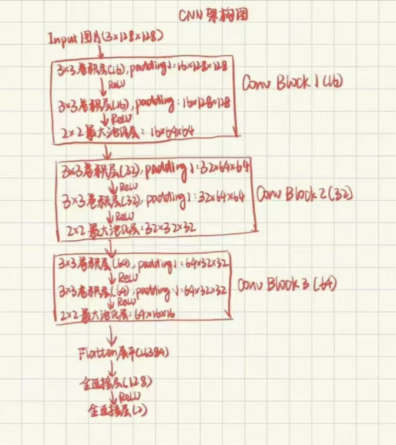
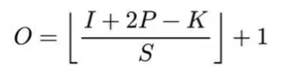
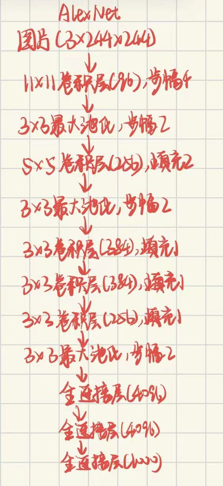

# 猫狗分类
## 实践1：各题具体操作代码与结果见对应notebook
1. 像素是图像的基本组成单位，每个像素通过数值表示图像对应位置的颜色或亮度信息；RGB是一种颜色表示方式，代表红、绿、蓝三个颜色通道。每个通道有自己的颜色强度，组合起来可表示不同的颜色；灰度图只有一个通道，通过不同灰度值表现图像明暗变化；彩色图有三个通道，通过不同通道颜色分量的强度组合表现颜色信息
2. 具体分布操作与说明见[image_teat_ipynb](./实践1/image_test.ipynb)
3. 卷积核是一个处理图片的工具，本质是一个在图片上移动的小权重矩阵。移动的过程中依次对路径范围里的像素加权求和（卷积运算），得到的结果逐个排列就形成了处理后的图像；他在图片上根据步幅跳跃运动；到了一个位置将范围内像素信息与自身对应的权重信息分别相乘再求和得到结果
4. 手写代码见[Conv2d_test_ipynb](./实践1/Conv2d_test.ipynb)
5. 具体实践与结果比较见[Conv2d_test_ipynb](./实践1/Conv2d_test.ipynb)
6. 均值和高斯模糊卷积核利用周围的像素信息加权平均，减小了一定范围内的像素差异，因此更加模糊；锐化卷积核利用自身的正权重与周围像素负权重加权求和，放大中心与周围像素的差距。边缘区域的像素与周围差异大，因此会被放大，更加明显；图像边缘的像素亮度会发生明显变化,sobel的两个卷积核能比较左右/上下两侧的亮度，若有变化则会响应，就找到了边缘
7. 卷积核大小、padding、stride与输出尺寸之间满足：out_h = (H + 2 * padding - KH) // stride + 1
out_w = (W + 2 * padding - KW) // stride + 1
* 若图像卷积完成后，部分结果小于0或大于原来的像素范围，需要裁剪超出范围的部分，确保正确显示

## 实践2：各题具体操作代码与结果见对应notebook
4. 图片形状变化：
输入shape： (1, 3, 128, 128)
features层0:Conv2d,输出shape:(1, 16, 128, 128)
features层1:ReLU,输出shape:(1, 16, 128, 128)
features层2:Conv2d,输出shape:(1, 16, 128, 128)
features层3:ReLU,输出shape:(1, 16, 128, 128)
features层4:MaxPool2d,输出shape:(1, 16, 64, 64)
features层5:Conv2d,输出shape:(1, 32, 64, 64)
features层6:ReLU,输出shape:(1, 32, 64, 64)
features层7:Conv2d,输出shape:(1, 32, 64, 64)
features层8:ReLU,输出shape:(1, 32, 64, 64)
features层9:MaxPool2d,输出shape:(1, 32, 32, 32)
features层10:Conv2d,输出shape:(1, 64, 32, 32)
features层11:ReLU,输出shape:(1, 64, 32, 32)
features层12:Conv2d,输出shape:(1, 64, 32, 32)
features层13:ReLU,输出shape:(1, 64, 32, 32)
features层14:MaxPool2d,输出shape:(1, 64, 16, 16)
classifier层0:Flatten,输出shape:(1, 16384)
classifier层1:Linear,输出shape:(1, 128)
classifier层2:ReLU,输出shape:(1, 128)
classifier层3:Dropout,输出shape:(1, 128)
classifier层4:Linear,输出shape:(1, 2)
5. 不同通道关注不同特征，如在notebook演示的随机测试中，channel8关注水平边缘，channel12关注整体轮廓
6. 不同超参数与数据增强实验见[试验记录](./实践2/CNN/炼丹记录.xlsx),样本展示位于notebook对应单元格。翻转可能改变具有方向意义的特征；裁剪可能丢失关键特征；过度颜色扰动可能破坏有效的颜色信息
7. 错误样本展示分析和混淆矩阵见notebook对应单元格。结果显示狗的图片有更大概率被识别错误，并且错误展示中大部分图片颜色区分度低，轮廓模糊，初步尝试改进预处理再次测试，但实际效果一般...二次观察发现图片强行转换size造成的拉伸很容易弱化狗的特征（如外凸的嘴），尝试新预处理方案：长边缩到128，短边不足区域padding。然而这种方案会导致模型学习padding，故效果也一般，后续考虑尝试剪裁方法
8. 单独推理程序：[推理程序](./实践2/CNN/predict.py)
9. 模型结构图：

## 趁热打铁：
1. 卷积层能够聚合像素周围信息，捕捉空间局部特征，且卷积核不受绝对位置影响，参数可共享，利用了平移等变性；而全连接层将所有像素展平，缺乏对局部空间结构的直接利用，并且参数量庞大，容易过拟合
2. 卷积层输入通道表示每组卷积核要处理的输入特征图数量，也即每组卷积核的卷积核数量。所有特征图分别经对应卷积核处理再相加，加上偏置；输出通道指该层的卷积核组数量，每组卷积核对所有输入特征图处理后得到各自的输出特征图，有几组卷积核就有几个输出，最后形成输出通道数个特征图输出
3. 公式如下：

I：输入特征图的宽或高
K：卷积核大小
P：Padding
S：Stride
O：输出特征图的宽或高
e.g.:第一个卷积层：128=(128+1×2-3)/1+1
4. 网络加深需要提取更深的特征，就需要聚合更大范围的信息。因此采用池化、更大的步幅等方法扩大感受野，这个过程就会减小尺寸，同时也能减小计算开销；随着网络变深，深层特征更多更复杂，需要采用更多卷积核以从不同角度提取特征，提高表达能力。每组卷积核都能生成各自的特征图，于是通道数增加
5. ReLU，交叉熵损失。ReLU引入非线性，且梯度计算简单稳定；交叉熵损失衡量两个类别分数与真实标签的差异，优化它能有效提升二分类问题准确度
6. 随机数据增强是为了提升模型泛化能力，缓解过拟合，是用于训练的方法。对验证集和测试集随机数据增强还会干扰验证集和测试集的评估，降低其稳定性和可比性;翻转可以增强模型对不同朝向的适应能力，但可能改变具有方向意义的特征；裁剪可降低对位置变化的敏感性，但可能丢失关键特征；颜色扰动可以增强对不同光照条件的适应能力，但过度扰动可能破坏有效的颜色信息

## 拓展:各题具体操作代码与结果见对应notebook（[拓展](./实践2/CNN/extra_mission.ipynb)）
1. 
- AlexNet采用5个卷积层+三个全连接层的结构，第1，2，5个卷积层后使用最大池化。5个卷积层大小依次为11*11，5*5，三个3 * 3， 通道数变化为96-256-384-384-256，特征图尺寸逐渐减小，采用了Dropout，ReLU，数据增强等技术，参数量大约在6000万
- VGG(以VGG-16为例)由5个卷积块(block)组成，每个block包含两到三个3*3卷积层，最后使用2*2最大池化减小尺寸，通道数逐渐增加。5个block后使用展平并用3个全连接层得到最终结果，共计16层，参数量约1.384亿。VGG提出了重复使用多个卷积块加深网络的方法，能逐步扩大感受野，引入更多非线性变换
- ResNet(以ResNet-18为例)共计18层，在初始卷积后进行最大池化，再通过4个stage(每个stage包含2个basicBlock，每个BasicBlock的主分支包含2个3×3卷积层，并使用batchNorm、ReLU和残差连接)，对结果进行全局平均池化，最后输入全连接层得到结果。最初的卷积核7 * 7，之后使用3 * 3，通道数逐渐增加，尺寸逐渐减少。模型使用了残差连接，参数量约1169万，远少于VGG-16，而模型更深。残差连接保证了网络在增加层数的过程中进行增量表达，在模型原有表达能力上扩展，并缓解了梯度消失问题
2. 浅层的通道响应差异更明显,保留了更多图像细节;深层的空间响应更加粗略、概括，表现了更深层更整体的信息。因为浅层仅聚合了小范围信息，只能表示细节特征，而深层感受野更大，聚合各细节特征得到更深层的表示
3. baseline准确率：80.93%，bottleneck准确率：66.64%。二者训练时间和参数相差不大，baseline参数略高，训练时间略低————Bottleneck在这个小任务中不合适
4. AlexNet：
- 结构图：

