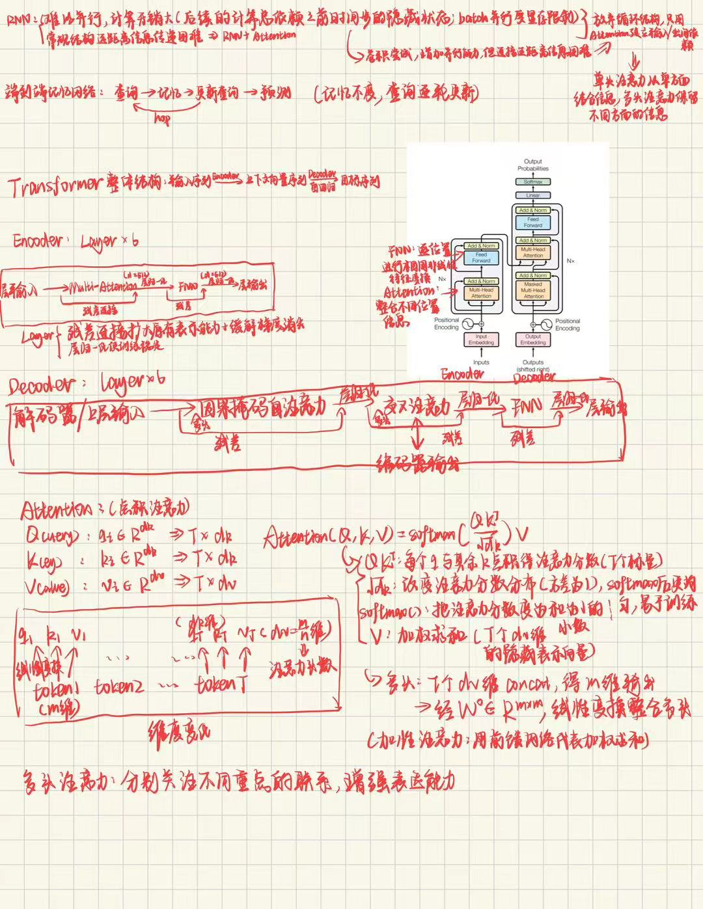
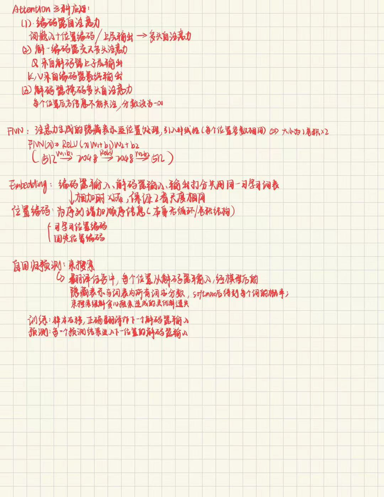

# All you need is attention
## 任务:
1. 简化Transformer结构图:

2. 术语理解：
- Scaled Dot-Product Attention:缩放点积注意力由原序列线性变化而来的QKV计算得到。每个位置生成同维的q和k，并用q对其他所有位置的k做点积，经过分布缩放后由softmax得到一系列和为1注意力分数，所有位置的v通过这些注意力分数加权求和得到这个位置的注意力隐藏表示
- Multi-Head Attention:多头注意力引入n个注意力头，每个都有自己的QKV，其中V的维度由原维度线性映射分解得到(原维度/n)。每个注意力头重复缩放点积注意力的流程，每个位置得到n个原维度/n维的表示，再concat并通过一个维度不变线性映射整合各个注意力头信息，得到最后的隐藏表示
- Position-wise Feed-Forward Network:逐位置FNN对上一步注意力层得到的T个隐藏表示分别处理，本质是一个隐藏层大小更大的MLP，在原论文中采用512-＞2048-＞512，ReLU激活。FNN的作用是进一步整合处理隐藏表示，引入非线性扩大模型表示能力
- Positional Encoding:位置编码是让模型识别序列顺序信息的方法。transformer没有循环和卷积结构，只有通过为序列每个位置增加一个表示位置的编码，来提供位置信息。一般分为固定位置编码和可学习位置编码
3. 阅读笔记：

采用原文阅读＋ai辅助翻译理解的方法。阅读时对多头注意力的维度变化和公式里的根号dk有疑惑。询问ai，ai进行公式推导和举例后理解。疑问：transformer编码器多层的注意力都是在注意上一层的输出，因此可以不断深入探索规律，但是解码器每次都是交叉注意同一个编码器输出，这样会不会让多层堆叠没有那么有效。可能解释：解码任务重点是对编码结果的分析，因此只需要单独更新Q从不同角度不同深度注意编码器输出即可
4. 机器翻译任务
- 不用RNN：循环结构使同一序列难以并行，若要batch并行计算开销大；远距离的信息传递困难，距离远的信息需要通过多个隐藏状态传递（门控神经网络已有效缓解）
- 不用CNN：CNN增加了并行能力，但是远距离信息传递仍旧困难，感受野只能逐渐扩大，堆叠多层才能建立远距离依赖。而Transformer完全采用attention，同一序列某位置可直接与任意位置交互，并行容易
5. “自”注意力，即查询（q）和关注的信息（k,v）均来源于自身序列；普通的attention则是一个序列的q查询其他序列的kv
6. 在自注意力中，QKV来源于同一个序列的不同的可学习的线性变换，其中QK有相同维度。线性变换不同让模型在不同特征空间分担查询，匹配和信息传递的任务，增强注意力表示能力
7. 点积的结果是一串实数，通过softmax把整串实数转换为一行行和为1的注意力分数权重，它表示某个位置关注其他位置的“关注度”大小，用于之后的加权求和
8. 每个头有独立的qkv，能从不同角度捕捉序列内部关系。多个头是多个互相独立的过程，不仅仅是重复，他们各自计算一套隐藏表示最后整合，让注意力表达能力更强
9. 采用位置编码，在编解码器输入的词嵌入加入位置编码，即使词嵌入相同不同位置得到的最终输入也不同，可以编码词语先后顺序
10. 解码器只能通过已有信息预测后方，遮住使其仅能通过已有信息推理，防止提前知道答案。如果能提前知道，模型就无法训练得到预测未知信息的能力
11. 残差连接在编解码器每个子层前后，作用是在模型原有基础上学习增量表示，同时缓解梯度消失问题。层归一化在残差连接之后，作用是调整数值分布，使训练更平稳。FNN在编解码器的最后一个子层，目的是处理每个位置隐藏表示，增强特征表示能力，引入非线性

## 拓展：
1. 见2.
2. 代码见[attention_test_py](./attention_test.py), [attention_test_ipynb](./attention_test.ipynb)

3. ViT：输入图片，把原始图片分为一个个小patch（保留通道），每个ptach展平为一维，通过线性变换映射到特定维度，得到每个patch的对应patch embedding（对应transformer的token embedding），再加入patch的图像块位置编码（对应tranformer的位置编码）与可学习的CLStoken，得到序列就是transformer的输入。自注意力位于这个原始输入序列之后，在跟transformer相同架构的编码器子层中。自注意力让不同patch信息相互整合交互，同时让CLS聚合所有信息，得到最终分类。VIT使用的是encoder-only架构，只使用编码器部分。它只需做图片分类，得到了编码器对图像的隐藏表示输出，把CLStoken的隐藏表示输入分类头就足以完成任务
4. 
- encoder-only：ViT：结构如上，训练目标是得到图像聚合信息后的隐藏表示，并输入分类器头完成图像分类任务
- decoder-only：GPT：由数个因果掩码自注意力和FNN组成的自注意力块组成，已生成序列输入模型，经这样的解码器结构输出目标位置的隐藏表示，结合词表得到最大概率的输出。其目标是得到已有序列聚合信息后的隐藏表示以生成下一个token，适用于逐token自回归生成的任务
- 结构选择：有的任务目标是探索输入的内在联系和隐藏表示，以得到输入的某些特征信息，就适合encoder-only。encoder-only适合需要充分利用整个输入、提取整体特征的任务；有的任务目标是结合已知信息自回归生成内容，因此需要因果掩码自注意力，适合decoder-only。decoder-only适合需要遵循因果顺序、根据已有 token 自回归预测后续token的任务