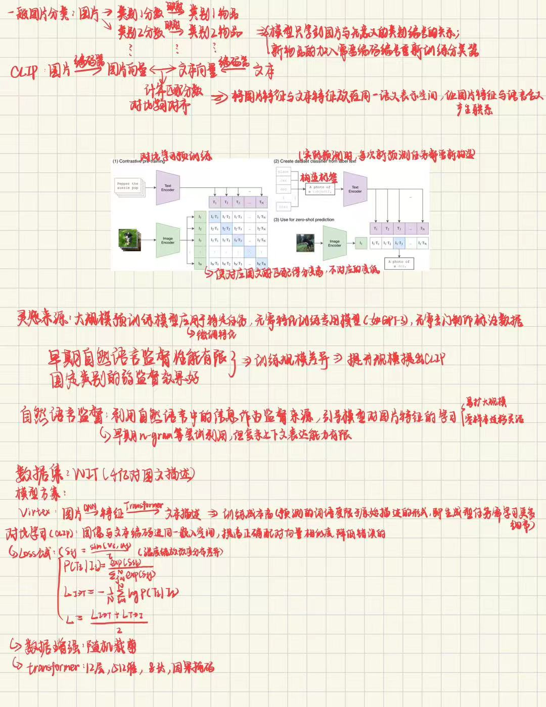

# Task 5：VLM从这开始 —— CLIP
## 任务 1：阅读 CLIP
- 手写笔记：

1. 传统图像分类模型需要原始图片与固定的预测标签之一。CLIP采用自然语言监督学习，需要图片和与之对应的文字描述以突破固定标签类别的限制，且这个图文对需要相当大的规模，因此选择使用互联网上的“图片—文字”对
2. 图像编码器和文本编码器，两个编码器把输入内容编码得到结果后进行线性投影，变为同一个特征空间的同维向量
3. 图文对齐指对应的图片和文本经编码器得到的特征向量尽量接近，且与不匹配的向量差距较大，即二者有相似的隐藏表示；只有向量接近才说明二者表达的信息相匹配，否则无法建立视觉信息与自然语言语义之间的对应关系
4. 这N张图片和N段文字分别得到各自的隐藏表示，如Figure 1中依序排列为表格，则对角线上的为正样本，其余为负样本。对具体某个向量而言，只有同行（列）编号相同的才是正样本
5. 训练目标是让所有的隐藏表示的向量都与和它匹配的向量接近，不匹配的相离，最终优化两个编码器使特征空间中图片信息与文本信息相对应，即图文对齐。它通过减小自定义的Loss，优化编码器实现。Loss由文本对图片和图片对文本两部分取均值得到。每一项都是图片（或文本）各向量交叉熵损失的均值，取平均的每一项由每一个向量对所有其他种类向量求内积后采用带温度的softmax并处理后得到匹配分数，再取负对数得到
6. zero-shot classification指已有模型训练任务之外的其他预测标签，即没有专门特化过分类器的候选类别；只给出名称，文本编码器就能编码理解标签含义，并在特征空间中与图片向量实现对应
7. prompt engineering指设计和调整提示词使其更符合模型，让模型效果更好；可能，因为模型预训练采用的是自然语言文本，a photo of a dog更贴合模型常见的文本描述
8. CLIP的能力源于数据集的图文对，文本描述的准确度有很大影响。文本描述中不常涉及的，如物品详细种类，物品数目等会影响模型对这类任务的处理能力，如判断物品数目，细粒度物品分类等（以前网上有ai无法理解蛋炒饭里没有豌豆的例子，可能就是因为训练数据中一直都是这样，但没有对此增加详细描述，模型没有学习相关知识）。这说明CLIP还是没有做到完全理解文本语义，在文本底层理解上有待提升；互联网图文数据带来的偏见或错误关联正是如此，描述中的不详尽不准确甚至错误和刻板印象都会被模型记住；这说明大模型训练时需要保证数据质量，需要在数据规模、多样性和质量三者之间取得平衡
## 任务 2：让 CLIP 配对图片和文字：见[practice](./practice_2.ipynb)
## 趁热打铁：
1. 因为图片特征和文本特征在隐藏向量上维度相同，且经过语义对齐。编码器输出要满足输出维度相同，论文采用了输出维度相同的线性映射
2. 避免不同特征向量的点积受到向量长度不一致的影响，进而影响相似度计算；L2归一化保证了向量长度都为一，点积的结果就等于余弦相似度
3. 两个方向保证了对两个检索方向都提供监督,使同一图片对其他描述和同一描述对其他图片的Loss整体达到最低；不这样可能导致出现多对一的情况，如只计算T->I，能保证一个文本向量只有一张最佳图片匹配，但可能同一图片与多个描述匹配度相近，在图片的描述区分度上表现不佳
4. 我们再来正面回答一下原问题：不是；从未见过指的是模型没有学习该内容的相关知识和表示，而zero-shot指的是预训练学习到相似知识后不再用标注数据特化训练模型，直接用任务目标类别构造分类器预测
5. 这个系数是“温度”系数的倒数，当它变大会增加softmax分布的差距，让高的更高，进而增大对结果的置信度，变小同理
6. 模型可能认为这两个东西理应同时出现，把雪地当作北极熊的特征之一，机械地记忆二者的组合，当北极熊单独出现可能判断出错；这种偏见让模型错误地理解物品特征，在其中某个物品单独出现时判断出错
7. 以文搜图，图片分类，多模态基础，内容筛选